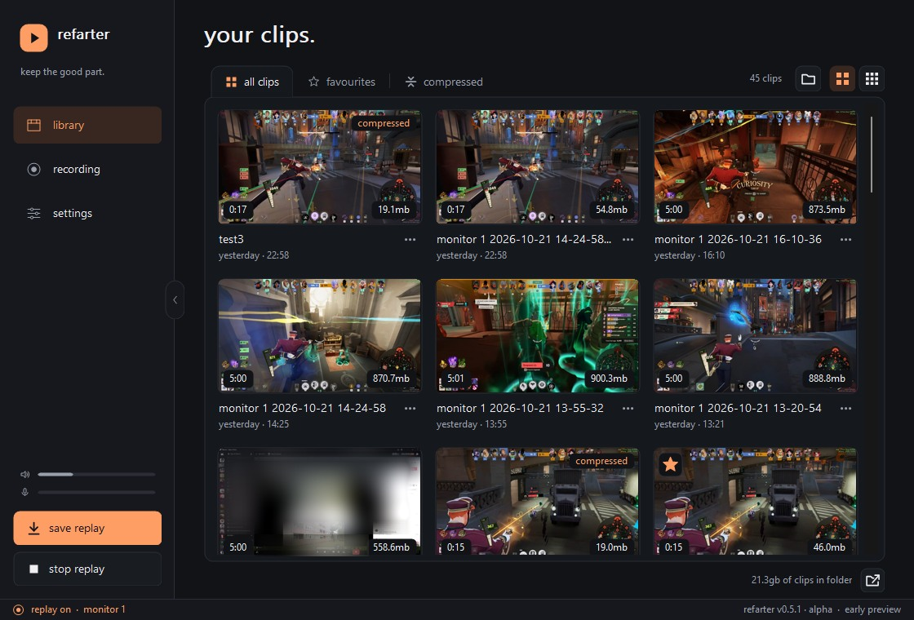
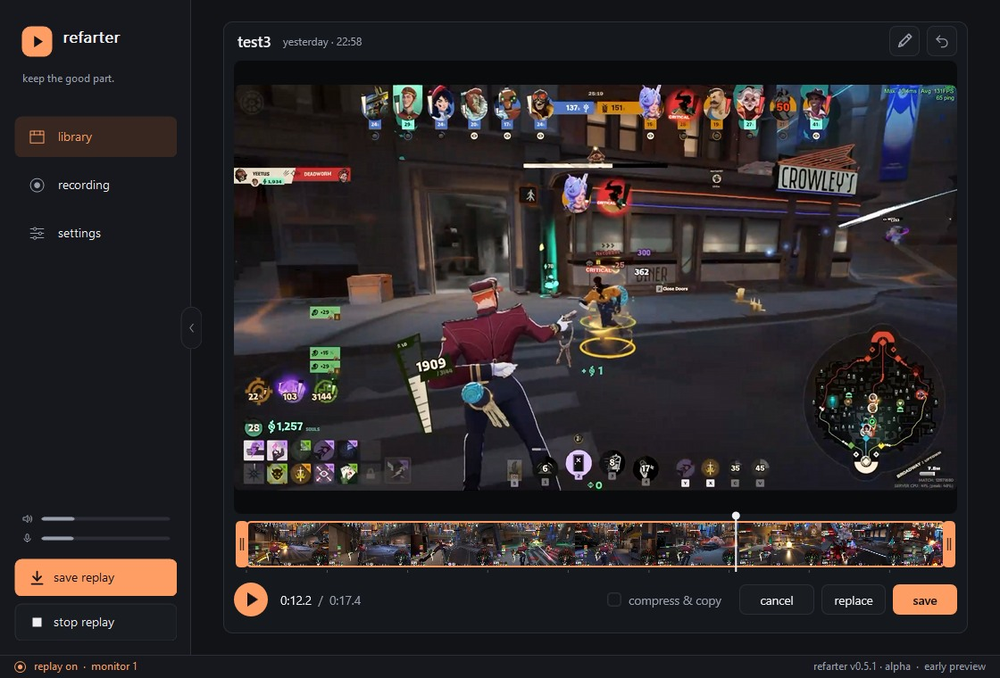
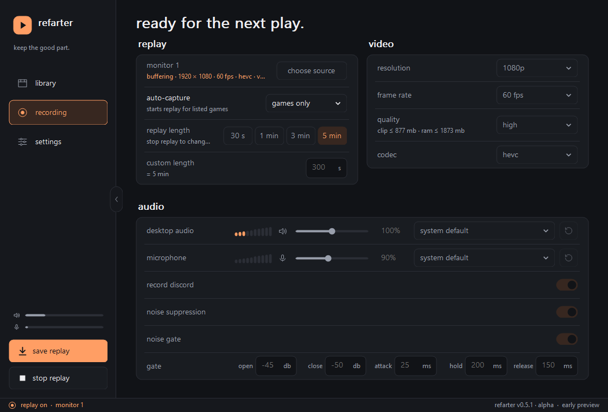

<p align="center">
  
</p>

<h1 align="center">Refarter</h1>

<p align="center"><em>just three bros. one idea. one method.</em></p>

<p align="center">
  <strong>Instant replay for Windows games. Press a key, keep the good part.</strong>
</p>

<p align="center">
  
  <a href="LICENSE"></a>
  <a href="https://github.com/matonico/Refarter/releases/latest"></a>
</p>

<p align="center">
  <a href="https://github.com/matonico/Refarter/releases/latest"><strong>Download for Windows</strong></a> ·
  <a href="#get-started">Get started</a> ·
  <a href="#faq">FAQ</a>
</p>

<p align="center">
  
</p>

Refarter keeps the last few minutes of your game in memory. When something happens that's worth keeping, press one shortcut and it's saved as a clip, without leaving the game. Then watch it, cut it down and share it, all in the same small app.

It's built in the spirit of the old ShadowPlay: quick to open, cheap to leave running, and focused on one job. It's a dependable replay button, not a streaming suite.

## What it does

- **Instant replay.** Keeps anything from the last 5 seconds to the last hour (three minutes by default) in RAM. Nothing is written to disk until you save.
- **Shortcuts that work in game.** Save the replay, or a full-resolution screenshot, while your game has focus. Assign any keys you like.
- **Records only what you choose.** One game window or one monitor. Recording continues through Alt-Tab and never switches to the desktop or another app.
- **Starts by itself.** Auto-capture starts replay when a game on your list comes to the front.
- **Light on your PC.** Uses your GPU's hardware encoder: H.264, plus HEVC and AV1 where supported. Frames stay on the GPU until they are compressed.
- **Audio on separate tracks.** Desktop, microphone and Discord each get their own track beside a mix. The microphone has noise suppression and a noise gate.
- **Watch and trim.** A built-in player handles H.264, HEVC and AV1 with no codec packs. Trimming copies the video without re-encoding and keeps only the audio sources you switch on; with two or more of them, a new audio mix is encoded.
- **A tidy library.** See durations and sizes at a glance. Search, favourite, rename, group clips by game, drag them straight into Discord or a folder, and bin the ones you don't want.
- **Share-sized copies.** "Compress to 20 MB" makes a copy small enough for Discord and leaves the original as it was.

<table>
  <tr>
    <td width="50%"></td>
    <td width="50%"></td>
  </tr>
  <tr>
    <td align="center"><sub>Lossless trimming in the player</sub></td>
    <td align="center"><sub>Source, length, video and audio in one page</sub></td>
  </tr>
</table>

## Yours, on your PC

No account, advertising, telemetry or cloud. Your clips and settings stay on your PC. When replay is off, Refarter sits idle. The one optional exception is the [update check](#updates), which is off until you agree to it.

### Updates

Refarter never contacts the internet on its own until you say so. The first time its window is in front it asks whether it may check for a newer version; the answer is stored under `[updates]` in `refarter.ini` and can be changed in **settings** at any time. If you agree, at most once a day, a little after start-up, Refarter asks GitHub whether a newer release exists. Only the request itself is sent: your IP address and `Refarter/<version>` as the user agent. Nothing is downloaded and nothing is installed; a newer version only adds a small "update available" note in the footer that opens the release page in your browser. **check for updates** in **settings** asks right away, whatever the switch says. If GitHub can't be reached, nothing is shown except a note on that settings row.

## Get started

1. Download the installer (`Refarter-<version>-setup.exe`) or the portable zip from [Releases](https://github.com/matonico/Refarter/releases/latest). The installer needs no administrator rights.
2. Open **recording** and choose a game window (or a whole monitor) as the source.
3. Press **enable replay** in the sidebar.
4. Play, and press <kbd>Ctrl</kbd>+<kbd>Shift</kbd>+<kbd>F10</kbd> when something worth keeping happens.
5. Open **library** to watch, trim, rename, compress or favourite the clip.

**You need:** Windows 10 version 2004 or later (64-bit), a GPU with a hardware H.264 encoder, and enough free RAM for your replay length (the recording page shows an estimate).

So far Refarter has been tested mainly on NVIDIA GeForce RTX cards. AMD and Intel GPUs, HDR, multi-monitor setups and many games haven't been covered yet. [Bug reports](https://github.com/matonico/Refarter/issues/new/choose) help a lot.

### Shortcuts

| Key | Action |
| --- | --- |
| <kbd>Ctrl</kbd>+<kbd>Shift</kbd>+<kbd>F10</kbd> | Save the replay, even in game (change it under **settings**) |
| <kbd>Ctrl</kbd>+<kbd>Shift</kbd>+<kbd>F11</kbd> | Save a screenshot of what you are recording, into a `screenshots` folder beside your clips |
| <kbd>Ctrl</kbd>+<kbd>F</kbd> | Search the library (<kbd>Esc</kbd> clears) |
| <kbd>F2</kbd> / <kbd>F</kbd> | Rename / favourite the selected clip |
| <kbd>Ctrl</kbd>+<kbd>C</kbd> | Copy the selected clips as files, ready to paste into Discord or Explorer |
| <kbd>T</kbd> | Trim the clip open in the player |

## FAQ

<details>
<summary><strong>Windows says "Windows protected your PC" when I start it.</strong></summary>

Refarter isn't code-signed yet, so SmartScreen doesn't recognise it. Choose **More info**, then **Run anyway**. To check that your download is intact, compare it with `SHA256SUMS.txt` on the release page.

</details>

<details>
<summary><strong>The save shortcut does nothing in one particular game.</strong></summary>

First, check that replay is on: the shortcut only saves while there is a replay to save. Refarter listens for the shortcut in two ways, so most games can't swallow it. However, if a game runs as administrator, Windows doesn't pass its key presses to normal apps. Try a different shortcut under **settings**. Or Alt-Tab and press **save replay** in the sidebar, which saves the same replay.

</details>

<details>
<summary><strong>My clip is black or empty.</strong></summary>

- Choose the game's own window as the source, not its launcher.
- If the game was minimised when replay started, go back to it: Refarter waits up to ten seconds for a real picture, then asks you to try again.
- Exclusive fullscreen hasn't been tested much yet. If it records black, try borderless or windowed mode, or record the whole monitor instead.
- Some apps hide themselves from screen capture (protected video, for example). They record as black on purpose.

</details>

<details>
<summary><strong>I have a Windows "N" edition.</strong></summary>

N editions ship without Windows' media components, which Refarter needs for encoding. The installer offers to add the Media Feature Pack for you. If you use the portable zip, add **Media Feature Pack** yourself under **Optional features** in Windows Settings, then restart.

</details>

<details>
<summary><strong>Where are my clips, settings, logs and crash dumps?</strong></summary>

- **Clips:** `Videos\Refarter` in your user folder, unless you chose another folder under **settings**. The folder button in the library opens it.
- **Settings:** `%LOCALAPPDATA%\Refarter\refarter.ini`. Delete it to go back to the defaults.
- **Logs:** turn on **diagnostic logging** under **settings → app**. Logs then go to `%LOCALAPPDATA%\Refarter\logs`. They contain no window titles, file names or key presses, and nothing is uploaded.
- **Crash dumps:** if Refarter crashes, it leaves a `.dmp` file in `%LOCALAPPDATA%\Refarter\crashes` (the newest ten are kept). Nothing is uploaded.

Uninstalling keeps your clips.

</details>

<details>
<summary><strong>Something went wrong. How do I report it?</strong></summary>

Open a [bug report](https://github.com/matonico/Refarter/issues/new/choose). The form asks for your Refarter version, Windows build, GPU and driver, and your recording settings. If you can, turn on diagnostic logging, reproduce the problem, and attach `session.log`. After a crash, also attach the newest file from `%LOCALAPPDATA%\Refarter\crashes`. Unlike the log, a dump can contain bits of window titles, clip names or folder paths that Refarter had in memory, so only attach it if you are fine with that.

</details>

## Building

You need Visual Studio 2022 with the **Desktop development with C++** workload and its English language pack (set `$env:VSLANG = '1033'` so build messages come out in English). Inno Setup 6 is only needed to build the installer (`.\scripts\build-installer.ps1 <version>`).

```powershell
.\scripts\build.ps1
ctest --test-dir build -C Release --output-on-failure
```

The first build downloads and builds FFmpeg, dav1d and RNNoise into `.deps\` (a few minutes, internet needed once). Close a running Refarter before rebuilding.

## Licence

Refarter is free software under the [GNU General Public License v3.0](LICENSE). You may use, change and share it; changes you distribute stay under the same licence. Bundled third-party code keeps its own licence (see the [third-party notices](THIRD_PARTY_NOTICES.md)).
